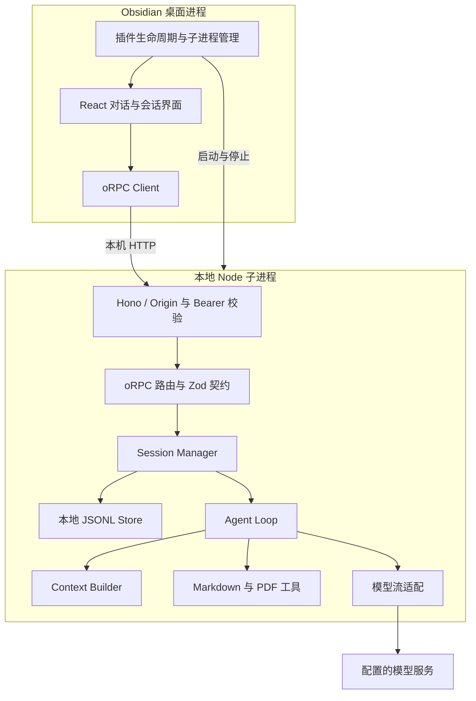
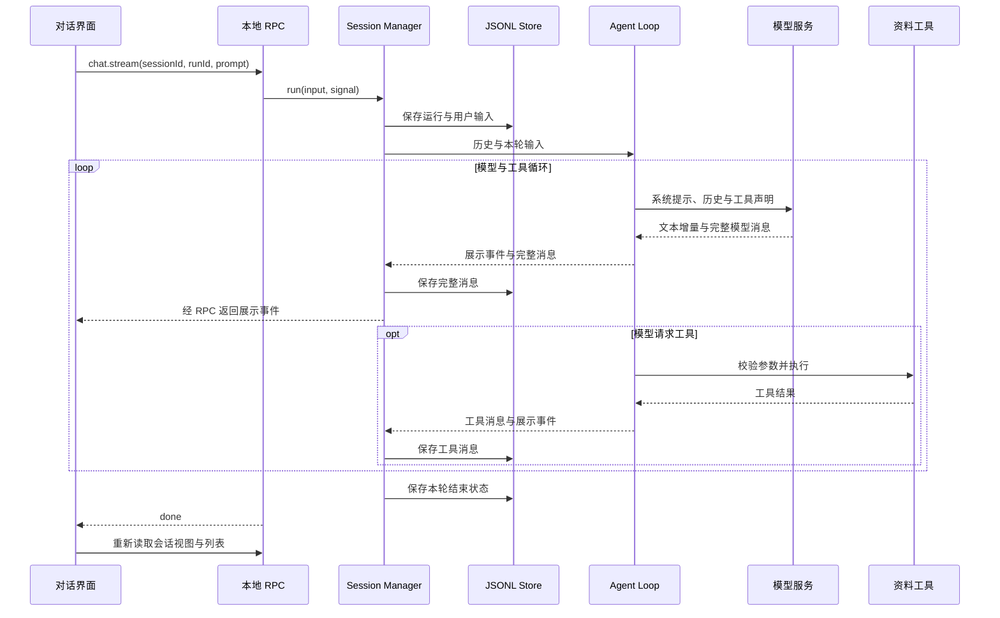

# Jelly 当前架构

## 模块边界

| 模块                     | 职责                                                        |
| ------------------------ | ----------------------------------------------------------- |
| `apps/obsidian-plugin`   | Obsidian 生命周期、侧栏、服务进程管理、RPC 客户端和界面状态 |
| `apps/agent-service`     | HTTP、RPC、模型传输、资料工具与会话存储的业务组装           |
| `packages/agent-runtime` | Agent Loop、单次模型调用、Context 组装和工具注册执行        |
| `packages/contracts`     | oRPC 接口、Zod 运行时校验及客户端类型                       |
| `packages/domain`        | 消息与运行事件类型                                          |
| `packages/ui`            | 宿主无关的 React 展示组件                                   |

Runtime 和 UI 不直接依赖 Obsidian API。Service 组装具体文件工具、模型传输与 Session；Runtime 不直接读写会话文件。

## 请求与持久化

UI 只发送本轮问题和标识，不上传自行拼接的完整历史。Session 负责恢复历史、运行生命周期和持久化；Runtime 负责推进模型与工具循环。完整历史留在服务端，展示事件不包含全部内部消息。

会话接口提供创建、列表与读取。JSONL Store 按会话排队执行文件操作，使用 UUID 生成文件名。当前设计面向单个 Service 进程，不提供多进程共享写入协调。

## 启动与配置

插件分配回环端口、生成随机令牌并启动 Node 子进程。Service 加载环境配置，初始化会话、工具与模型传输，再开始监听。插件等待带令牌和 Origin 的 readiness 检查成功后注册视图；卸载时停止子进程。

开发模式通过本机 Node 与 tsx 加载源码，从仓库根目录读取可选 `.env`。生产构建将完整服务代码内嵌在 `main.js` 中，插件启动时在 `.runtime/<内容哈希>/` 内准备 ESM 服务和 CJS 引导入口，经 `@electron/remote` 调用宿主的 `utilityProcess.fork` 创建独立 Node 子进程；服务工作目录为生成入口所在的版本化缓存目录，模型和目录配置由宿主显式注入，不读取旧插件 `.env`。模型 Key 与本地通信令牌用途不同。

主进程中的宿主启动器将服务绑定到所属窗口：文档重载、窗口销毁或渲染进程退出时终止服务，并在退出后移除事件监听；超时使用 SIGKILL，避免强制重载留下旧服务。

独立进程边界、HTTP/oRPC、启动令牌和 readiness 检查保持不变。生产包只交付 `main.js`、`manifest.json`、`styles.css`，无需外部 `node` 命令或单独下载服务文件。服务 ESM 构建提供 `createRequire` 兼容层，用于打包后的 CommonJS 依赖。

设置页只提供 API Key、API 地址和模型名称。地址与模型通过插件 loadData/saveData 保存，Key 使用 Obsidian SecretStorage。无 Key 的生产首装先注册视图和设置入口，不启动模型服务；保存后串行停止旧服务、启动新服务并刷新界面连接。文件工具范围固定当前 Vault，会话固定 Vault/.jelly/sessions；开发模式在没有已保存 Key 时保留仓库 .env 回退。宿主适配已在 macOS / Electron 43.3.0 验证，其他平台、安装程序版本和社区审核仍需验证。

## 数据边界

- 文件工具限制在 `JELLY_DOCS_DIRECTORY` 配置的资料目录，解析实际父目录后检查越界。Markdown 支持增删改查，PDF 仅支持读取，不操作文件软链接。
- 本地 RPC 校验 Origin 与启动令牌，服务只绑定回环地址。
- 系统提示词要求把工具内容视为资料；实际文件访问范围由工具代码检查。
- 模型请求会携带对话及使用到的资料内容，发送到用户配置的服务。
- 会话保存用户、模型和工具消息；错误、取消与中断状态用于恢复及界面呈现。

## 资料工具

Service 将以下工具注册给 Runtime，不依赖 Obsidian API：

| 工具                 | 行为                                                             |
| -------------------- | ---------------------------------------------------------------- |
| `list_project_docs`  | 递归列举资料目录内的 Markdown 和 PDF 路径                        |
| `read_project_doc`   | 返回全文和内容版本 `revision`                                    |
| `create_project_doc` | 新建文件，父目录须存在，同名文件不覆盖                           |
| `edit_project_doc`   | 提交读取时的 `revision`，将唯一匹配的 `oldText` 替换为 `newText` |
| `delete_project_doc` | 提交读取时的 `revision`，永久删除单个文件                        |

修改、删除时版本不匹配会返回工具失败，模型应重新读取。同一工具实例内，同文件操作串行；修改先写临时文件再替换原文件。版本检查不是跨进程文件锁，外部编辑器仍可能在最后检查与提交之间修改文件。

工具说明要求仅在用户明确要求写入或删除时执行；当前没有产品层逐次确认面板、回收站或撤销功能。聊天中正常的总结请求不应被当作写文件授权。资料目录不会自动扩大为整个 Vault。

### PDF 读取

`read_pdf({ path, startPage?, endPage? })` 在本地提取 PDF 文字层。页码从 1 开始，指 PDF 物理页码；默认从起始页读 5 页，不足则读到末页，单次最多 10 页。返回 `path`、`totalPages`、逐页 `pages` 和 `warnings`；每页含 `page`、`text`、`noText`、`truncated`。可通过后续工具调用继续读取其他页。

单文件上限 20 MiB，单次正文上限 60,000 字符；截断和未读取页会明确提示。单页超过上限时目前只能返回其前部文字，不能宣称读完。无文字页只表示未提取到文字，可能是空白、扫描件或无法提取的编码；不自动执行 OCR，不分析图片，也不保证还原表格、多栏排版。

解析使用固定版本 `unpdf@1.6.2` 内置的 PDF.js，已验证 Node 20.19.6；不依赖系统 Poppler、Python 或 Canvas，不调用模型 API。解析任务取消或退出时销毁资源；当前在 Service 内执行，不提供独立解析进程或强制 CPU 超时隔离。加密、损坏、非普通文件或无效页码返回工具失败，不改变原文件。PDF 列举及读取已具备，跨 PDF 正文搜索和持久化解析索引暂未实现。

当前不包含语义检索、Skills、MCP 或自动上下文压缩。这些能力不属于现有接口的隐含保证。
