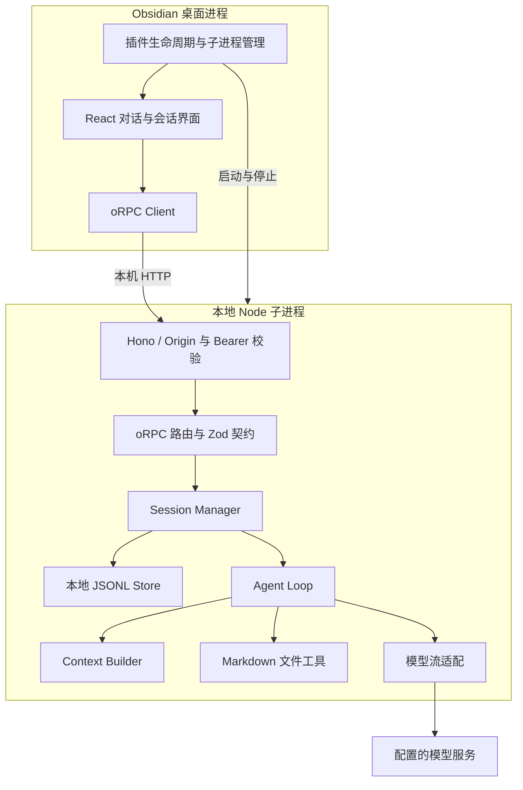
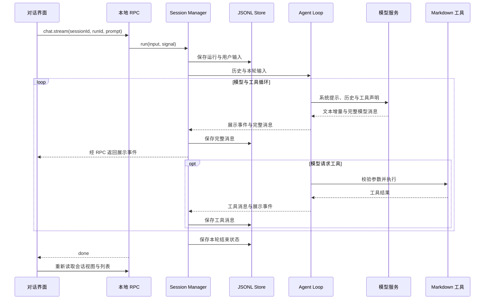

# Aula 当前架构

## 模块边界

| 模块                     | 职责                                                        |
| ------------------------ | ----------------------------------------------------------- |
| `apps/obsidian-plugin`   | Obsidian 生命周期、侧栏、服务进程管理、RPC 客户端和界面状态 |
| `apps/agent-service`     | HTTP、RPC、模型传输、资料工具与会话存储的业务组装           |
| `packages/agent-runtime` | Agent Loop、单次模型调用、Context 组装和工具注册执行        |
| `packages/contracts`     | oRPC 接口、Zod 运行时校验及客户端类型                       |
| `packages/domain`        | 消息与运行事件类型                                          |
| `packages/ui`            | 宿主无关的 React 展示组件                                   |

Runtime 和 UI 不直接依赖 Obsidian API。Service 组装具体文件工具、模型传输与 Session；Runtime 不直接读写会话文件。

## 请求与持久化

UI 只发送本轮问题和标识，不上传自行拼接的完整历史。Session 负责恢复历史、运行生命周期和持久化；Runtime 负责推进模型与工具循环。完整历史留在服务端，展示事件不包含全部内部消息。

会话接口提供创建、列表与读取。JSONL Store 按会话排队执行文件操作，使用 UUID 生成文件名。当前设计面向单个 Service 进程，不提供多进程共享写入协调。

## 启动与配置

插件分配回环端口、生成随机令牌并启动 Node 子进程。Service 加载环境配置，初始化会话、工具与模型传输，再开始监听。插件等待带令牌和 Origin 的 readiness 检查成功后注册视图；卸载时停止子进程。

开发模式通过 tsx 加载源码并从仓库根目录读取可选 `.env`；生产模式运行插件目录中的 `agent-service.mjs`，从该目录读取可选 `.env`。模型 Key 与本地通信令牌用途不同。

当前设置仍通过环境变量提供，资料与会话目录必须显式配置为绝对路径。生产版本依赖外部 `node` 命令，尚未提供普通用户设置页及标准社区安装包适配。

## 数据边界

- 文件增删改查限制在 `AULA_DOCS_DIRECTORY` 配置的资料目录，解析实际父目录后检查越界，只接受普通 Markdown 文件，不操作文件软链接。
- 本地 RPC 校验 Origin 与启动令牌，服务只绑定回环地址。
- 系统提示词要求把工具内容视为资料；实际文件访问范围由工具代码检查。
- 模型请求会携带对话及使用到的资料内容，发送到用户配置的服务。
- 会话保存用户、模型和工具消息；错误、取消与中断状态用于恢复及界面呈现。

## Markdown 工具

Service 将以下工具注册给 Runtime，不依赖 Obsidian API：

| 工具 | 行为 |
| --- | --- |
| `list_project_docs` | 递归列举资料目录内的 Markdown 路径 |
| `read_project_doc` | 返回全文和内容版本 `revision` |
| `create_project_doc` | 新建文件，父目录须存在，同名文件不覆盖 |
| `edit_project_doc` | 提交读取时的 `revision`，将唯一匹配的 `oldText` 替换为 `newText` |
| `delete_project_doc` | 提交读取时的 `revision`，永久删除单个文件 |

修改、删除时版本不匹配会返回工具失败，模型应重新读取。同一工具实例内，同文件操作串行；修改先写临时文件再替换原文件。版本检查不是跨进程文件锁，外部编辑器仍可能在最后检查与提交之间修改文件。

工具说明要求仅在用户明确要求写入或删除时执行；当前没有产品层逐次确认面板、回收站或撤销功能。聊天中正常的总结请求不应被当作写文件授权。资料目录不会自动扩大为整个 Vault。

当前不包含语义检索、Skills、MCP 或自动上下文压缩。这些能力不属于现有接口的隐含保证。
