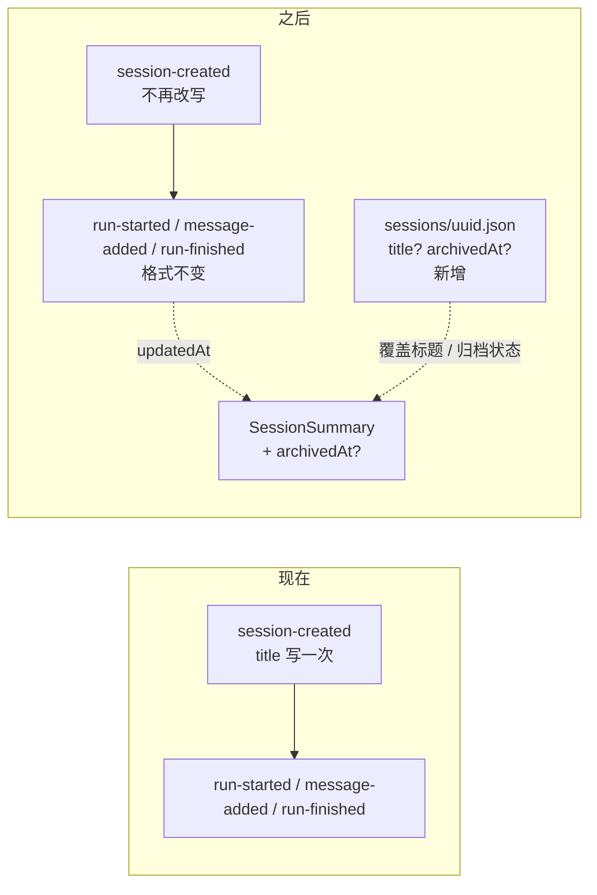

# 0004：会话元数据与对话日志分开存储

状态：提议（proposed）

## 背景

JELLY-5 要给会话补改名、归档、还原和彻底删除。现在的持久化只有一条：每个会话一份 JSONL，记录会话头、Run 开始、消息、Run 结束四种记录（`apps/agent-service/src/session/records.ts:26-47`），标题写在会话头里、`version: 1`、永不更新。

于是要新增的"标题覆盖、归档时间"必须落到某个地方。这不只是一次性小改动：它决定以后会话级属性（分类、置顶、归档排序）能不能扩展，也决定用户回退旧版本时会不会读不出会话。

关键约束来自现有代码：

- `restore()` 假定会话头之后的每条记录都属于某个 Run，顺序不符就抛错（`apps/agent-service/src/session/session.ts:40-50`）。
- `recordSchema` 是严格判别联合，未知 `type` 直接校验失败（`records.ts:26`）。
- `updatedAt` 取最后一条记录的时间（`session.ts:55`），任何写入都会影响排序。
- `list()` 已经会读取全部会话文件（`session.ts:222-227`），再加一次小文件读取成本可忽略。

## 数据模型：前后对比

现在会话只有一个文件，标题写死在头记录里，没有地方放归档状态。

字段变化只有两处：

| 对象 | 现在 | 之后 |
| --- | --- | --- |
| `SessionSummary` | `id / title / updatedAt` | 加 `archivedAt?: string` |
| `SessionMeta`（新文件） | 不存在 | `version / title? / archivedAt?` |
| 四种 JSONL 记录 | 不变 | 不变 |

## 备选

### 甲：元数据写成 JSONL 记录

追加 `session-renamed / session-archived / session-unarchived`，`restore()` 折叠出最新值。

- 优点：不加新文件，`append` 直接可用。
- 缺点：必须重排 `restore()` 的 Run 校验；旧版本读新文件整条失败（回退即数据"看不见"）；元数据写入会改变 `updatedAt`；对话日志与 UI 状态混在一起，以后每加一个会话属性都要再动 Run 折叠逻辑。

### 乙：每个会话一份旁挂元数据 JSON（提议采用）

`<uuid>.json`，对象结构带自己的 `version`，原子写；缺文件即默认值。

- 优点：JSONL 与模型协议完全不动；旧读取器只扫 `*.jsonl`，会忽略元数据，降级为"归档会话重新出现"，不报错不丢数据；加字段是加法，分类等扩展不用迁移。
- 缺点：目录里多一类文件；跨两个文件的操作只有"彻底删除"，需要固定删除顺序并容忍残留；多一份小 schema 与"损坏按默认值"的约定。

### 丙：归档 = 把文件移到 `sessions/archive/`

- 优点：活跃列表扫目录即可。
- 缺点：同一会话路径随状态变化，读/追加/删除都要先探测位置；归档时间没有存储位（只能靠 mtime）；以后分类仍要另加元数据，等于两套机制。

## 决策（提议）

采用**乙**：

- 路径 `<vault>/.jelly/sessions/<uuid>.json`，内容 `{ "version": 1, "title"?: string, "archivedAt"?: string }`。
- 缺省与损坏都按默认值处理（未改名、未归档），不阻塞会话读取。
- 写入走临时文件 + `rename`，与同会话的 JSONL 追加共用按会话队列，保证串行。
- 彻底删除：先删 JSONL，再删元数据；元数据残留可清理，不算错误。
- 归档状态不参与模型历史；`beginRun` 拒绝已归档会话。
- 本轮不把分类字段写进 schema，但保留版本化对象作为扩展位。

## 影响

- 新增 ADR 后，`docs/architecture/current-runtime.md` 的"会话接口提供创建、列表与读取"（第 82 行附近）与 JSONL 存储说明要在实现合入时同步更新。
- 契约新增四个会话接口与 `archivedAt` 字段；插件与 Service 同版本发布，不保留旧版兼容分支（ADR 0002）。
- 回退做法：删除 `sessions/*.json` 即回到旧行为，归档会话重新出现在列表。
- 一旦实现，本条状态从 `proposed` 改为 `accepted` 需要用户确认；落地后再改为 `implemented`。

## 参考

- 方案全文：`docs/changes/JELLY-5-session-delete-and-ui/spec.md`
- [当前架构](../current-runtime.md)
- [0002：使用 oRPC 与 Zod 定义通信契约](./0002-contract-rpc.md)
