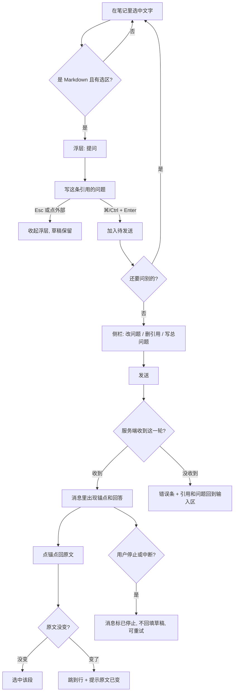
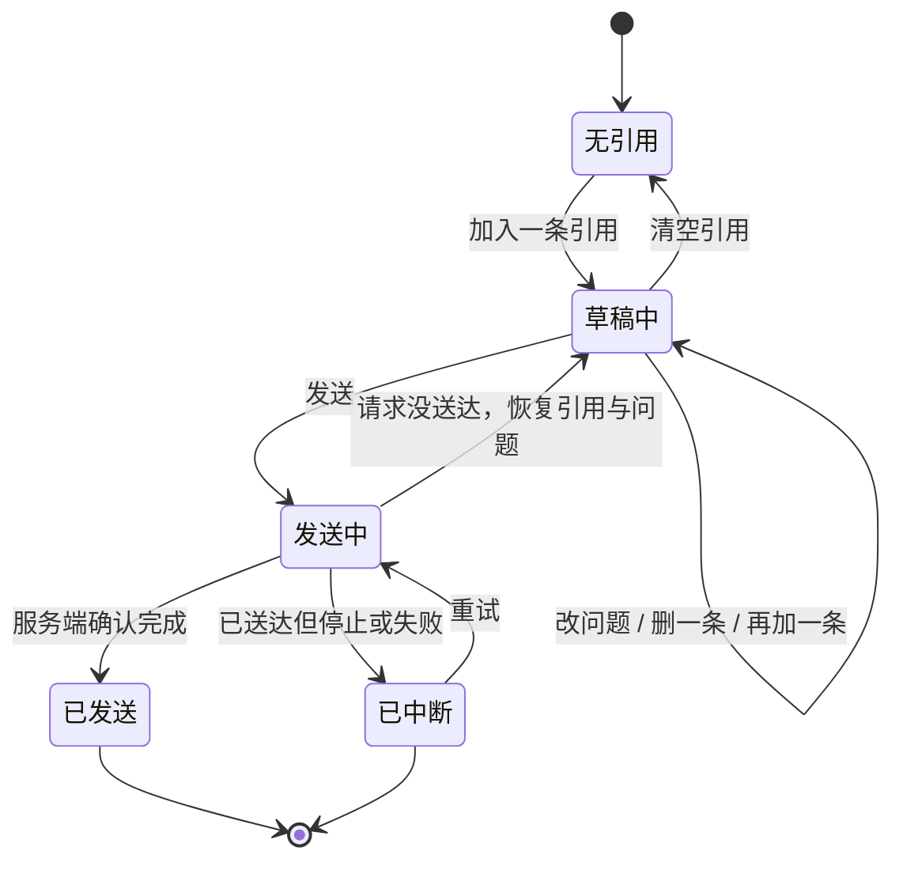
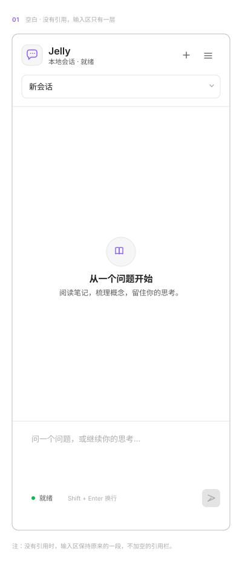
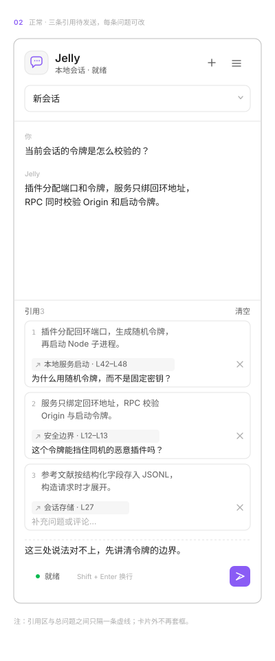
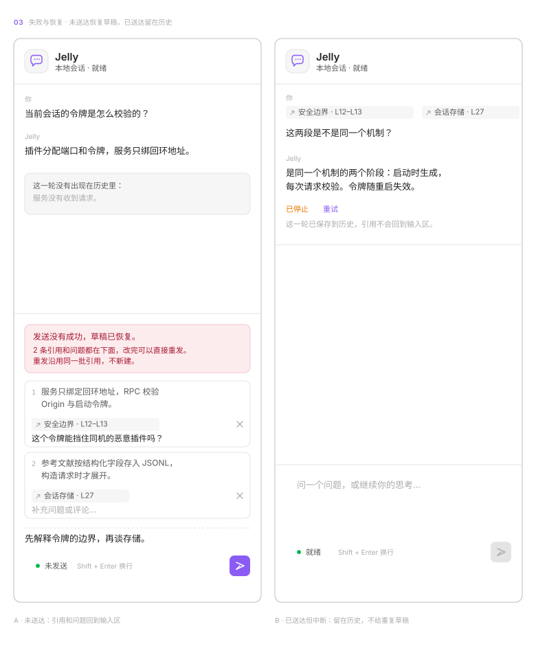
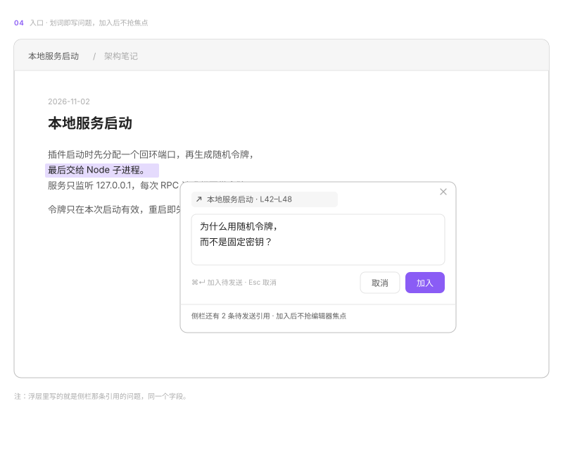

# 在笔记里划词，带着问题去问 Jelly

## 一句话

读 Markdown 时选中一段文字，写下问题，攒几条后一起发给 Jelly。回答里保留回到原文的入口。

## 问题

- 读长笔记遇到不懂的段落，用户要切到侧栏，再手动复述一遍上下文。复述到一半，问题常常就断了。
- PR #4 已经做出一版：划词 → 浮层「侧栏提问」→ 第二个浮层写问题 → 加入侧栏 → 发送。功能齐了，但入口分两步，问题有两个地方可写。
- 浮层里的「直接提问」是禁用按钮，一直挂着。
- 引用卡只显示「笔记名 · L12–L14」。三条引用来自同一篇笔记时，分不清哪条是哪条。
- 取消生成后，引用和问题会回到输入区。但这一轮已经写进历史，同一条提问出现两次。

## 目标

- 划词到提问只输入一次，不跳转，不丢焦点。
- 多条引用能辨认、能改、能删；发送前一眼看清要问什么。
- 发送后能从回答跳回原文；原文变了要说明。
- 失败和取消分开处理，不产生重复草稿。

## 不做

- 「直接提问」（临时问答，不进会话）：本轮只留结论，不实现。
- PDF 选区、图片选区、跨笔记批量引用。
- 在笔记里写高亮、批注或任何改动。
- 引用拖拽排序、分组、搜索。
- 阅读模式（Reading view）的划词：本轮只覆盖实时预览和源码模式，阅读模式延期，见风险第 1 条。
- 改动 Obsidian 主题、组件库、其他面板。

## 场景

### 1. 读笔记时问一段

- 谁：在 Obsidian 里读长笔记的人。
- 什么时候：读到一段卡住，想追问。
- 现在：切到侧栏，重新描述上下文，或者复制原文粘贴进去。
- 之后：选中文字 → 浮层里写问题 → ⌘/Ctrl + Enter。编辑器留在原处，焦点不跳。
- 图：线框 04。

### 2. 攒几条一起问

- 什么时候：同一节里有三处不清楚。
- 现在：一处处复制，或者来回切换七八次。
- 之后：侧栏里三张卡，每张有序号、两行原文、来源锚点、问题。改一条、删一条，写一句总问题，发送。
- 图：线框 02。

### 3. 发送失败

- 现在（PR #4）：错误条出现，引用回到输入区。但界面没说清是「服务没收到」还是「收到了但断了」。
- 之后：只有没送达才恢复引用，并明说「服务没有收到这一轮」。已经进历史的，不再放回输入区。
- 图：线框 03。

### 4. 生成被取消

- 之后：这一轮留在历史里，标「已停止」。锚点和每条问题都还在，可以点「重试」重新发一轮。输入区不再冒出同一批引用。

### 5. 回到原文

- 之后：点消息里的锚点回到笔记。原文没变，重新选中那一段；原文改过，跳到行并提示「原文已变化，快照仍在聊天里」。

## 方案

### 入口分工

一处输入，三个入口做同一件事。

- 划词浮层是主入口。停 180ms 出现，只放一个动作「提问」，点开就是问题输入框。
- 浮层里写的就是侧栏那条引用的问题，同一个字段。⌘/Ctrl + Enter 加入待发送，Esc 收起浮层并保留草稿。
- 加入后不打开侧栏、不抢编辑器焦点，只在浮层位置提示「已加入 · 3 条」。要整理时用户自己开侧栏。
- 侧栏负责查看、改问题、删引用、发送。不在浮层里发送。
- 右键菜单「加入 Jelly 提问引用」和命令面板「引用选中文字提问」保留，是同一动作的第二入口。不设默认快捷键，避免和宿主冲突。
- 删掉禁用的「直接提问」。

### 引用卡

- 一张卡四样东西：序号、两行原文、来源锚点、问题。
- 原文两行，超出截断。它是辨认依据，不是重复展示：三条来自同一篇笔记时，「L12–L14」认不出来。
- 锚点点一下回原文，锚点右侧是 ×，删掉这条。
- 序号和模型回答里的编号一致，用户知道第 3 条对应哪段回答。
- 标题行「引用 3」，右侧「清空」一次移除全部。草稿而已，不弹确认。
- 上限沿用 PR #4：30 条、单条原文 20,000 字符、合计 120,000 字符。到 20 条时在标题处提示剩余额度，不等发送才报错。
- 没有引用时，输入区保持原样，不显示空的引用栏。引用区和总问题之间一条虚线。

### 发送与回跳

- 发送时这一批立即移走并备份。成功丢弃备份，失败恢复。
- 消息里只放锚点，不重复原文；每条引用的问题显示在锚点下面。
- 点锚点：同文件已有标签就复用，没有就新开，跳到引用行。
- 原文没变：重新选中该段并聚焦编辑器。原文变了：跳到行，提示「原文已变化，快照仍在聊天里」。
- 文件被移动或删除：提示「引用的笔记已移动或删除，聊天中仍保留原文」。

### 流程

看这条线怎么从划词走到回答，以及两条失败分支。

所以方案定成：入口只有一个动作，失败按「有没有送达」分叉，取消不回填。

### 状态

看引用从草稿到历史的五种状态，重点是「发送中」只有两条去向。

所以「草稿中」只会从「没送达」回来。取消不再产生重复草稿。

## 界面与状态

四张线框图覆盖空白、正常、失败恢复和入口。它们是线框，不是高保真稿。

**空白：没有引用时，输入区只有一层。**

**正常：三条引用待发送，每条问题可以改。**

**失败与恢复：左边没送达，右边已送达但中断。**

**入口：划词后浮层里写问题。**

各状态在界面上长这样：

| 状态 | 消息区 | 输入区 | 发送按钮 |
| --- | --- | --- | --- |
| 空白 | 空态插画 | 只有输入框 | 禁用 |
| 草稿中 | 旧对话 | 引用卡 + 虚线 + 总问题 | 可用（引用非空即可发） |
| 生成中 | 流式回答 | 引用区已清空 | 变成停止 |
| 没送达 | 旧对话，无本轮 | 错误条 + 恢复的引用卡 | 可用，重发同一批 |
| 已送达但中断 | 本轮 + 「已停止」+ 重试 | 空 | 禁用 |
| 来源已变 | 消息照常 | — | — |

## 数据与边界

- 草稿：按会话存在插件配置里（saveData），不上传，不写 Vault。
- 已发送：随会话 JSONL 保存结构化引用。没有引用字段的旧会话按纯文本读，不做迁移。
- 原文快照：捕获时的一段文字，随消息一起保存。它可能和笔记现状不一致，界面要能说明这一点。
- 模型请求：构造请求时才把引用展开成带编号的文本，存储和界面保持结构化。
- 改动笔记：任何时候都不改。浮层、锚点、回跳都只读。
- 多窗口：另一个窗口要重新读取才看到新会话；本轮不做实时同步。

## 需要你定

1. **主入口**：A 浮层里直接写问题，加入后不抢焦点，侧栏负责整理和发送（推荐）｜B 浮层只放「加入」，问题只在侧栏写｜C 浮层里写问题并直接发送
2. **多条引用与回跳**：A 每张卡显示两行原文 + 锚点 + 问题，点锚点回跳（推荐）｜B 只显示锚点，精简｜C 卡片可展开完整原文
3. **本轮范围**：A 划词单入口 + 多条引用编辑 + 回跳 + 失败恢复（推荐）｜B 只做划词单入口与发送，其余延期｜C 再加阅读模式划词
4. **失败与取消**：A 按「是否送达」分开，没送达才恢复，已送达给重试（推荐）｜B 一律恢复草稿｜C 一律不恢复，失败只提示
5. **验收档位**：A 严格，含重启后草稿恢复、原文已变化的提示（推荐）｜B 只看发送成功与回跳｜C 再加多窗口一致

回复「1A 2A 3A 4A 5A」即可。

## 验收

- [ ] 实时预览和源码模式下划词，180ms 后出现浮层；浮层只有一个动作，没有禁用按钮。
- [ ] 浮层里写问题并 ⌘/Ctrl + Enter：引用进入侧栏，编辑器焦点不丢，出现「已加入 · N 条」。
- [ ] 连续加入 3 条不同笔记的引用，侧栏显示序号、两行原文、锚点、问题；能改问题、删一条、清空全部。
- [ ] 不写总问题、只带引用发送：能发出，消息里每条引用带锚点和它的问题。
- [ ] 点锚点回到原文并选中该段；原文改过之后跳行并提示原文已变化。
- [ ] 让服务不可用后发送：出现错误条，引用和问题回到输入区，提示写明服务没收到这一轮。
- [ ] 发送后中途取消：消息留在历史并标「已停止」，输入区没有重复引用，点「重试」能重新发。
- [ ] 关闭 Obsidian 再打开：未发送的引用和问题还在对应会话里。
- [ ] 280/360px 侧栏下，引用卡不横向溢出，问题单行不折行错位。
- [ ] 交付四张线框图，或 Paper 接通后补高保真。

## 风险

- 阅读模式还不支持划词。很多用户默认在阅读模式里读笔记，这一轮交付后他们会找不到入口。要么在阅读模式加一个「在 Jelly 里问这段」，要么在设置里说明。
- 浮层和 Obsidian 原生的选区菜单、插件快捷键可能抢事件。加引用后不恢复焦点是这次的核心手感，需要在真实宿主里试。
- 30 条 × 每条约 2 万字的上限会撑大模型请求，成本和延迟都会涨。上限是否收紧，留给架构方案定。
- 原地改笔记后再回跳，行号会漂移。目前只做到「跳到行 + 提示」，不保证选回原文。
- 引用草稿按会话保存。切换会话后，用户可能以为引用跟着走了。界面需要在会话切换时给出提示（这一条待定，不影响范围）。

## 原型

- 目标页：`Jelly · Obsidian UI Kit` → `JELLY-2 · 划词提问`。
- 当前 Paper MCP 报「Weekly MCP limit reached」，3 天后恢复。本轮的界面用线框图交付，写在 `images/` 下，随 PR 读得到。
- Paper 页等待补：空白、正常、失败恢复三屏高保真，复用 `02 · Obsidian Shell`、`03 · Jelly Chat`、`05 · Components`。
- 这不是完成了高保真，只是没被卡住。补图后再更新本节。

## 交接

- 下一阶段：架构方案
- 进入条件：「需要你定」1–5 有结论；Paper 补图不阻塞架构（界面结构以线框图为准）
- 需要读：本文件、四张线框图、`docs/architecture/current-runtime.md`、PR #4 的 `references/` 与 `session.ts`
- 本轮没有代码改动，没有跑测试；现状描述按 PR #4 的代码核对。
