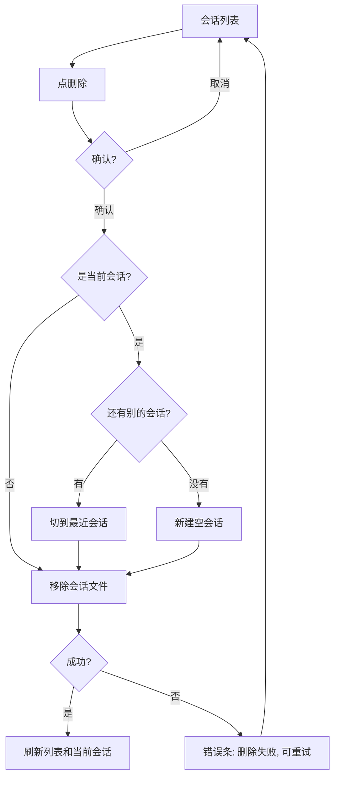

# 删除会话，让侧栏更清爽

## 一句话

让用户能删掉不用的会话，并让 280–360px 的侧栏少一点重复标题、多一点留白。

## 问题

- 新建会话后没有删除入口。会话越积越多，列表里只能靠日期分辨。
- 面板上有两处标题行：品牌头和“对话”头。状态点、提示、消息数量挤在输入框周围。侧栏一窄，内容就显得拥挤。
- 删除不是加一个按钮。会话的接口、存储、界面都没有删除能力；这轮要把整条链路补齐。

## 目标

- 能删除指定会话。取消不删，失败可重试。
- 删除后列表、当前会话、重启后的状态一致。
- 侧栏在 280–360px 下，新建、切换、删除、发送四个操作一眼能看到。
- 删除只影响这个会话，不碰笔记、PDF 和资料目录。

## 不做

- 批量删除、清空全部、导入导出、搜索、置顶、归档、分组。
- 删除用户笔记、PDF 或资料目录。
- 全面重写界面、更换组件库、另起一套视觉体系。
- PR #4 引用提问、PR #1 Skills、模型配置。

## 场景

### 1. 删一个不用的会话

- 谁：单个用户，本地 Obsidian。
- 什么时候：列表里积累了误建或已经结束的会话。
- 现在：只能留着。
- 之后：点会话右侧的删除图标，确认后消失。

### 2. 删当前会话

- 现在：只能切到别的会话，把旧的留着。
- 之后：确认后删除，界面切到最近更新的另一个会话。
- 如果删完一个不剩：落到一个可用的新会话，不出现空白错误页。

### 3. 删除失败

- 现在：没有删除，也就没有失败。
- 之后：面板里出现错误条，会话还在，可以重试。
- 不能出现“界面删了，刷新又回来”。

### 4. 侧栏更清爽

- 现在：品牌头 + “对话”头，两处标题；输入区围着一圈 10–11px 的辅助文字。
- 之后：只留一处标题；状态和快捷提示收进输入区；消息与输入区层次清楚。
- 目标：首屏能看到新建、切换、删除、输入四个动作。

## 方案

### 删除流程

### 界面

- 会话列表每一行右侧一个删除图标。鼠标移上去或选中时可见。
- 点删除，弹一次确认框。标题写会话名/日期，正文写“不会删除笔记和 PDF”。
- 当前会话正在生成时，删除图标禁用，鼠标悬停说明“生成中不能删除”。
- 删除中按钮显示加载状态；失败时面板内出现错误条，会话保留。
- 删除当前会话后，切到最近更新的另一个；删到空时新建一个空会话（待确认，见问题 2）。

### 清爽化

- 合并品牌头和“对话”头，只留一行。
- 输入区只留状态点和发送/停止；`Shift + Enter` 提示移到 placeholder 或帮助里。
- 间距按 8px 节奏：区块之间 24，组内 8–12；消息之间 20–24。
- 不改消息渲染、引用交互、模型配置。

## 需要你定

1. 删除入口：A 列表右侧图标 + 确认（推荐）｜B 工具栏“删除当前会话”｜C 直接删 + 数秒撤销
2. 删到最后一个：A 自动新建空会话（推荐）｜B 停在空态
3. 未发送的引用草稿：A 一起删（推荐）｜B 保留
4. 会话标题：A 首条提问自动生成（推荐）｜B 不做｜C 支持重命名
5. 界面改动边界：A 小范围重排（推荐）｜B 只调间距/字号/颜色

回复“1A 2A 3A 4A 5A”即可。

## 验收

- [ ] 建几个会话，删一个非当前会话：列表少一条，刷新面板、重启 Obsidian 后都不再出现。
- [ ] 删当前会话：切到另一个已有会话，可以继续提问；最后一个删除后落到可用新会话，没有空白错误页或失效选中。
- [ ] 点取消：会话还在，聊天记录完整。
- [ ] 删除失败：有明确提示，会话未移除，恢复权限后重试成功。
- [ ] 当前会话生成中：删除入口禁用并说明原因。
- [ ] 280/360px：首屏能看到会话切换、新建、删除、输入；没有两处重复标题；消息区和输入区层次清楚。
- [ ] 交付同宽度、同会话状态的前后对比截图。

## 风险

- 用户可能以为删会话会删笔记/PDF；确认文案必须写清。
- 会话标题都是“新会话”时，用户不知道删哪个；问题 4 决定这轮是否先做标题。
- 多窗口不同步：另一个窗口下一次读取会发现会话没了，需要可恢复提示；本轮不要求实时推送。

## 原型

- Paper：`Jelly · Obsidian UI Kit` → `JELLY-5 · 会话删除`
- 页面里画了会话列表、删除入口、确认框，以及删除后的空态。
- 链接：[打开 Paper](https://app.paper.design/file/01M6H22NV4J9S83SQY6C9FNKF9)

## 交接

- 下一阶段：架构方案
- 进入条件：用户对问题 1–5 给出结论
- 需要读：本文件、Paper 原型、`docs/architecture/current-runtime.md`
