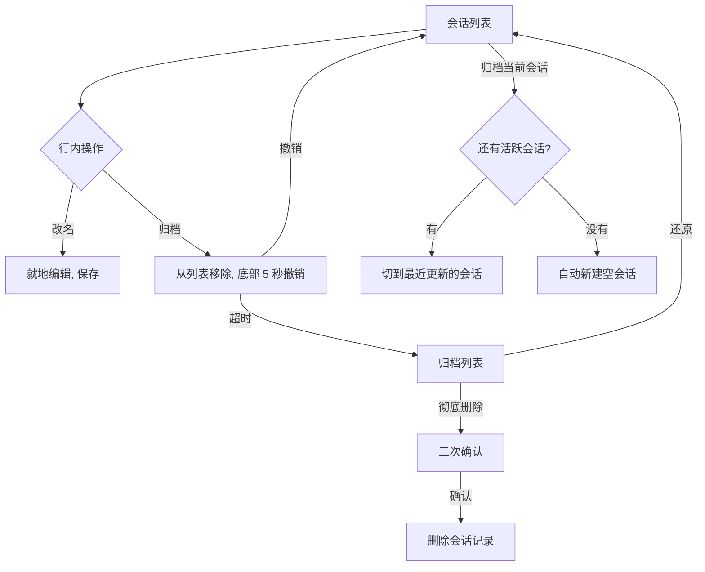
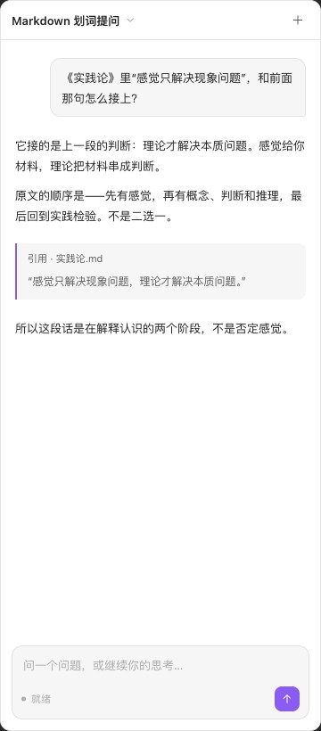
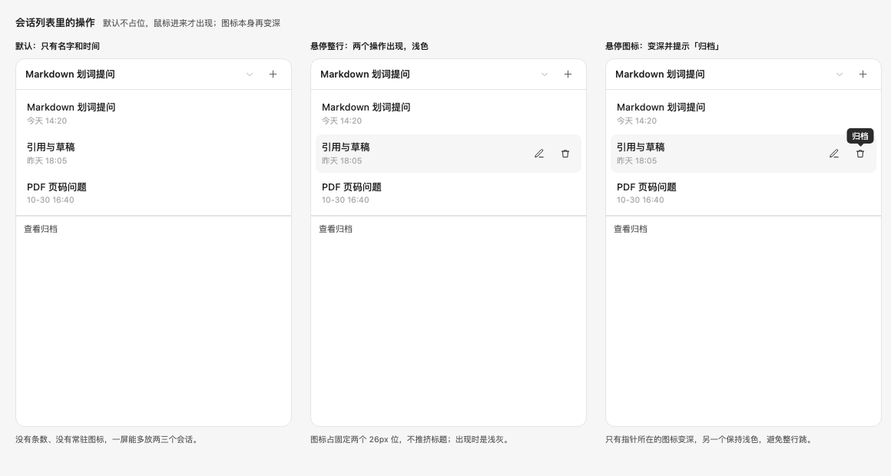
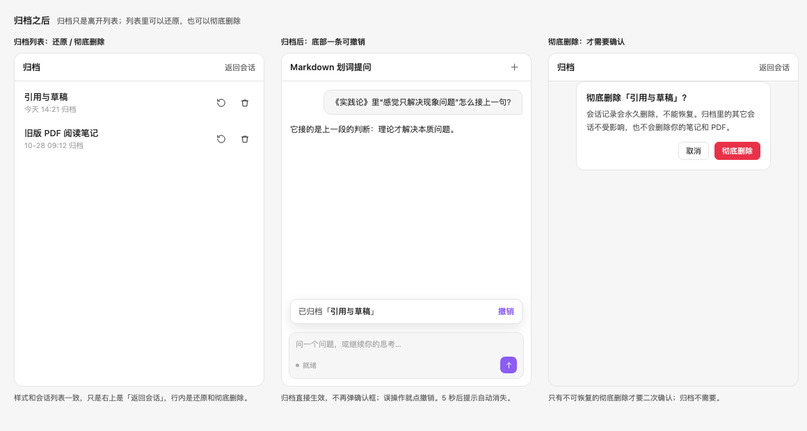
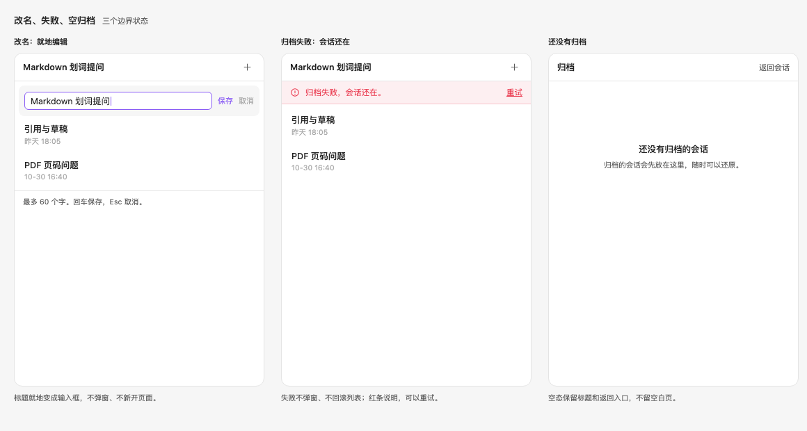

# 归档会话，补齐基础会话管理

## 一句话

让用户能改名、归档、还原和彻底删除会话；顶部只留当前会话名，侧栏更清爽。

## 问题

- 新建会话后不能改名，也不能删。会话越积越多，列表里只能靠日期分辨。
- 面板顶部有品牌名、图标和副标题，下面还有一行“对话”标题。两处标题占高度，内容一多就挤。
- 会话列表每行显示消息条数和日期。条数不重要，时间够用。
- 删除不是加一个按钮。会话的接口、存储、界面都没有改名、归档和删除能力；这轮要把基础会话管理补齐。

## 目标

- 会话支持新建、列出、改名、归档、还原、彻底删除。
- 归档只是从列表隐藏，数据还在；可以还原。
- 归档直接生效，底部给 5 秒撤销；彻底删除才弹确认。
- 归档最后一个会话后自动新建一个，界面上永远有可用会话。
- 顶部只留当前会话名；列表行内只留改名和归档，悬停才出现。
- 未发送内容只算输入框状态，不保存、不迁移；引用草稿同样不落盘。

## 不做

- 项目/知识分类、分组、搜索、置顶、批量操作。
- 归档列表的复杂管理；本轮只做还原和彻底删除。
- 删除笔记、PDF 或资料目录。
- 全面重写界面、更换组件库、另起视觉体系。
- PR #4 引用提问、PR #1 Skills、模型配置。
- 逐条规定界面文案。

## 场景

### 1. 改名

- 现在：所有会话都叫“新会话”，只能靠日期区分。
- 之后：鼠标移到会话行，右侧出现改名字段；点一下就地编辑，回车保存，Esc 取消。
- 名字最多 60 字；空名字不保存。

### 2. 归档

- 现在：不要的会话只能留着。
- 之后：鼠标移到行上，出现归档图标；点一下直接生效，行从列表消失，底部出现一条可撤销的提示。
- 5 秒内点撤销，会话回到原位；超时后进入归档列表。

### 3. 还原和彻底删除

- 归档列表和会话列表样式一致，只是行内操作换成还原和彻底删除。
- 还原后回到会话列表。
- 彻底删除才弹二次确认，并写明不可恢复；确认后删除会话记录。

### 4. 归档当前会话

- 如果还有别的活跃会话：切到最近更新的一个。
- 如果这是最后一个：自动新建一个空会话，立刻可以输入。
- 界面上永远有一个可用会话，不出现空白错误页。

### 5. 顶部和列表

- 顶部只留当前会话名、一个新建按钮和一个切换箭头；没有品牌名、图标和副标题。
- 当前会话名在第一次提问后自动变成问题摘要；没有提问时显示“新会话”。
- 列表每行只显示会话名和时间；消息条数不显示。
- 改名和归档图标默认隐藏；悬停整行出现浅灰，悬停到具体图标才变深。

### 6. 失败

- 归档失败：会话还在，列表不消失；顶部出现错误条和重试。
- 改名失败：保留编辑框里的内容，提示失败，可以再保存。
- 彻底删除失败：会话还在归档列表里，提示失败，可以重试。

## 方案

### 会话管理流程

### 界面

- 顶部：一行，当前会话名 + 新建 + 切换箭头。
- 会话行：标题 + 时间；悬停整行出现改名、归档图标；图标悬停变深。
- 归档列表：标题“归档”，右上角“返回会话”；行内还原、彻底删除。
- 归档反馈：底部撤销条，5 秒后自动消失。
- 彻底删除：确认框写明不可恢复。
- 改名：就地输入框，保存/取消；不弹窗、不跳页。
- 失败：错误条在顶部，会话不消失；重试入口就在错误条上。

### 数据与边界

- 归档是会话级状态，不删除 JSONL；还原只改状态。
- 旧会话没有归档字段时，默认按活跃处理。
- 会话列表只按 `updatedAt` 排序；时间格式沿用现有列表。
- 未发送内容不落盘；引用草稿也不落盘。PR #4 现在按 `sessionId` 存引用草稿，要改成不持久化，具体在 PR #4 里定。
- 引用的原文找不到时，直接删掉对应引用记录，不让会话因此变成死会话。
- 彻底删除只删该会话记录，不碰笔记、PDF、资料目录。
- 单进程服务：多窗口之间不实时同步，属预期行为，不作为本轮问题。
- 以后可能按知识/项目分类管理会话。数据模型预留分类字段或可扩展位置，列表组件保持可复用；本轮不实现分类 UI。

### 图

**主界面：顶部只留会话名**

**会话列表：默认、悬停整行、悬停图标**

**归档之后：归档列表、撤销条、彻底删除确认**

**边界状态：改名、归档失败、空归档**

## 已确认

2026-11-03 与 2026-11-04 已确认，不再有新的待定项：

1. 删除入口：C，直接生效 + 5 秒撤销。
2. 归档到最后一个：自动新建空会话。
3. 顶部：只留当前会话名。
4. 界面改动：小范围重排。
5. 未发送内容不保存，含引用草稿，一律不落盘。
6. 彻底删除不可恢复，必须在确认框里写明白。
7. 多窗口不同步属预期，不作为本轮问题。

## 验收

- [ ] 改名后刷新面板、重启 Obsidian，名字还在；空名字不保存。
- [ ] 归档后会话从列表消失，会话记录还在；5 秒内撤销能回来。
- [ ] 归档列表能还原；还原后回到会话列表。
- [ ] 彻底删除有二次确认，写明不可恢复；确认后会话记录删除，其他会话和笔记/PDF 不变。
- [ ] 归档当前会话切到最近会话；归档最后一个自动新建，界面立刻可输入。
- [ ] 行内图标默认隐藏，悬停整行出现，悬停图标变深。
- [ ] 顶部只有会话名 + 新建 + 切换；没有品牌名、图标、副标题。
- [ ] 列表只显示名字和时间，没有消息条数。
- [ ] 归档失败、改名失败、彻底删除失败都有错误提示，会话不丢。
- [ ] 未发送的引用草稿不落盘：重开面板或重启后不恢复。
- [ ] 侧栏 280/360px 下首屏能看到会话切换、新建、输入；没有重复标题。
- [ ] 提供前后对比截图（同宽度、同会话状态）。

## 风险

- 归档不是删除，用户容易误解；界面上要看得出来，但不逐条规定文案。
- 彻底删除不可恢复；确认框必须写清。
- PR #4 的引用草稿按会话持久化，和“未发送不落盘”冲突；要去掉持久化，具体在 PR #4 里定。
- 以后加分类会改列表结构；本轮只预留数据位，不做分类。

## 原型

- Paper：`Jelly · Obsidian UI Kit` → `JELLY-5 · 会话删除`
- 图已嵌入本文 `images/` 目录。
- Paper 本周 MCP 额度用满，部分图是线框图；额度恢复后同步进 Paper 页面。

## 交接

- 下一阶段：架构方案
- 进入条件：已满足。用户在 2026-11-04 明确同意推进（见 `confirmed` 最后一条）
- 需要读：本文件、`images/`、`docs/architecture/current-runtime.md`
