# 方案：会话元数据旁挂，归档与彻底删除走独立契约

这次要给会话加改名、归档、彻底删除。

难点不在按钮。标题写死在会话头里，JSONL 只存对话消息，系统里没有地方放"已归档"。

这篇先画清现在什么样，再画改成什么样，然后列出新增的实体、字段、接口，以及代价。

> 本文件由架构师在「架构方案」阶段维护。交互与原型由产品设计师提供（PRD + Paper 稿）。`status` 保持 `in-review`，用户确认关键选择后才进入规划。

## 1. 现在是什么样

### 1.1 模块与调用方向

先看模块。插件只做界面和 RPC 客户端；Service 里 Session Manager 管生命周期，JSONL Store 管文件。

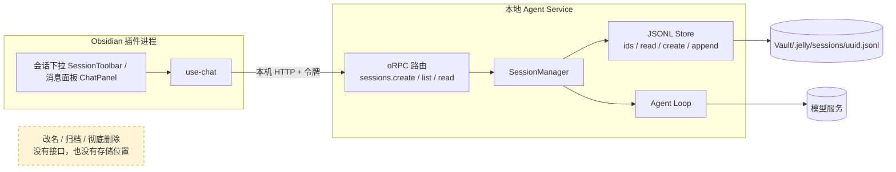

这张图看两件事：数据只有一条链路，会话的元信息没有独立位置；黄色块就是这次要补的缺口。

所以方案的第一步不是加按钮，而是先给"会话元数据"找一个家。

### 1.2 一次提问怎么落盘

图里能看出写盘时机：展示事件只走网络，完整消息才写文件。

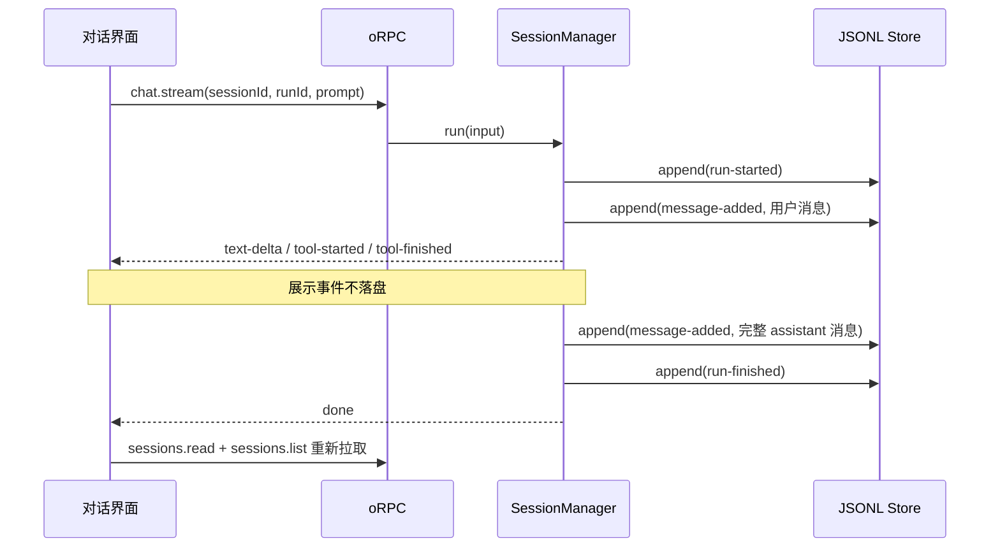

所以"改成什么样"必须保持这条链路：新功能只加会话级操作，不碰消息落盘。

### 1.3 现有字段结构

现在只有四个记录类型，全部在同一个 JSONL 里。标题在会话头里，写一次就不再变。

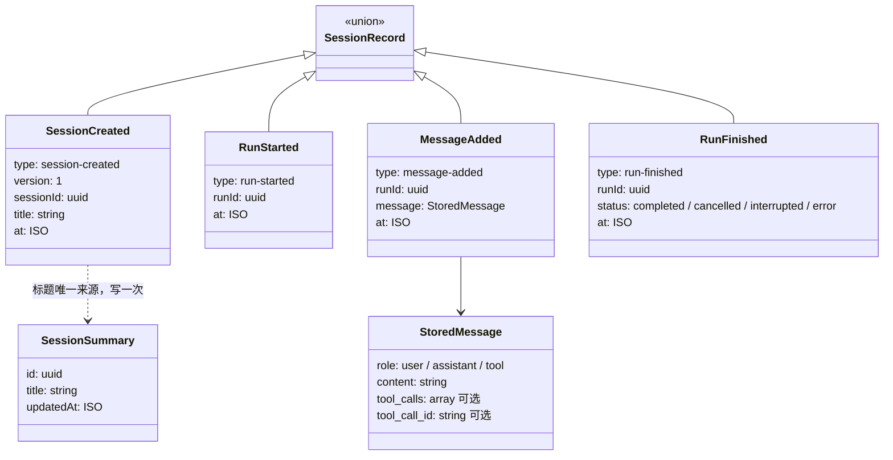

对应到代码：记录 schema 在 `apps/agent-service/src/session/records.ts:26-47`；对外摘要只有三个字段，在 `packages/contracts/src/index.ts:4-9`。

现有字段一览（谁写、谁读）：

| 对象 | 字段 | 类型 | 谁写 | 谁读 |
| --- | --- | --- | --- | --- |
| `session-created` | `version` | 字面量 `1` | `SessionManager.create` | `restore()` |
| `session-created` | `title` | `string` | `SessionManager.create`，之后不再写 | `restore()` → 列表与顶部 |
| `session-created` | `sessionId` / `at` | `uuid` / ISO 时间 | 同上 | 同上 |
| `run-started` | `runId` / `at` | `uuid` / ISO 时间 | `beginRun()` | `restore()` |
| `message-added` | `runId` | `uuid` | `beginRun()` / `appendMessage()` | `restore()` → 模型历史与界面 |
| `message-added` | `message` | `StoredMessage` | 同上 | `toHistory()` / `view()` |
| `run-finished` | `status` | 四种状态 | `finishRun()` | `restore()` |
| `SessionSummary` | `id` / `title` / `updatedAt` | `uuid` / `string` / ISO 时间 | `list()` 从文件计算 | 会话下拉与顶部 |

### 1.4 为什么加不了

- `restore()` 假定"会话头之后的每条记录都属于某个 Run"，顺序不符就抛错（`apps/agent-service/src/session/session.ts:40-50`）。往 JSONL 里加非消息记录，会直接破坏这条规则。
- `recordSchema` 是严格判别联合，未知记录类型校验失败（`records.ts:26`）。旧版本读新文件，整条会话都读不出来。
- `updatedAt` 取文件最后一条记录的时间（`session.ts:55`）。元数据一旦写进 JSONL，就会改变列表排序。
- 界面用的是 Radix `Select` 下拉（`packages/ui/src/SessionToolbar.tsx:71-114`），项里放不了可点击的行内按钮。

## 2. 目标与差异

目标：

1. 会话能改名、归档、还原、彻底删除。
2. 列表分清活跃和归档；归档行显示归档时间。
3. 归档掉最后一个活跃会话时，服务端保证还有可用会话。
4. 标题在第一次提问后变成问题摘要，用户改名优先。
5. 顶部只留会话名 + 新建 + 切换箭头，行内操作悬停出现。

差异一眼看：

| 维度 | 现在 | 之后 |
| --- | --- | --- |
| 会话接口 | `create / list / read` | 再加 `rename / archive / unarchive / delete` |
| 会话元数据 | 只有会话头里的初始标题 | 独立元数据对象，可反复写 |
| 列表含义 | 全部会话，按 `updatedAt` | 默认只列活跃，归档单独列 |
| 标题 | 常量"新会话" | 改名优先，否则首条提问摘要 |
| 删除 | 没有 | 删文件，不可恢复 |
| 顶部 UI | 品牌块 + 下拉 | 会话名 + 箭头 + 新建 |

不改变：

- JSONL 记录格式与 `version: 1`。
- 模型协议消息仍只有 user / assistant / tool，元数据不进模型历史。
- `chat.stream` 入参与 `done` 语义。
- 单进程模型，不做多窗口同步。
- 引用草稿持久化的问题留在 PR #4，本方案不动它的代码。

## 3. 改成什么样

### 3.1 目标架构

只加一个存储位置和四个接口，其他链路不动。

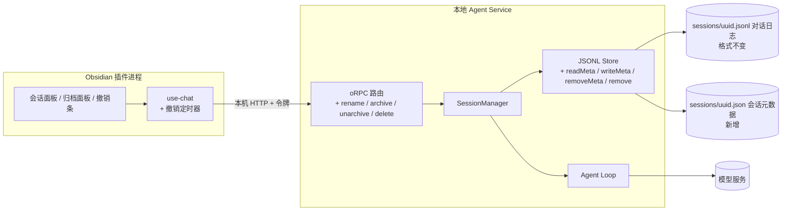

关键变化只有一个：Store 从"只管一份 JSONL"变成"对话日志 + 会话元数据"。

### 3.2 新增的实体与字段

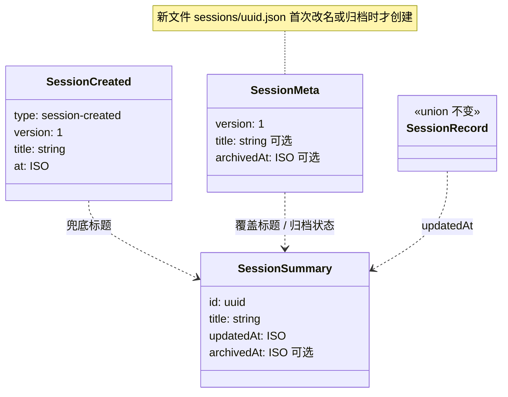

字段前后对照：

| 对象 | 字段 | 现在 | 之后 | 默认 | 谁写 | 谁读 |
| --- | --- | --- | --- | --- | --- | --- |
| `SessionMeta`（新） | `version` | — | 字面量 `1` | 必须写 | `writeMeta` | `readMeta` |
| `SessionMeta`（新） | `title` | — | `string?`，trim 后 1–60 字 | 缺省 = 未改名 | `rename` | `list` / `view` |
| `SessionMeta`（新） | `archivedAt` | — | ISO 时间 `?` | 缺省 = 活跃 | `archive` / `unarchive` | `list` / `view` |
| `SessionSummary` | `archivedAt` | 没有 | `string?` | 缺省 | `SessionManager` 合并 | 会话面板 / 归档面板 |
| `SessionSummary` | `title` | 直接取头记录 | `meta.title ?? 首问摘要 ?? 头标题` | 头标题 | `SessionManager` | 两个面板 |
| `sessions.list` 入参 | `archived` | 没有 | `boolean?`，默认 `false` | `false` | 面板 | `SessionManager` |
| 错误结果 | 错误码 | 只有通用 `INTERNAL_SERVER_ERROR` | 加 `NOT_FOUND` / `CONFLICT` | — | `rpc.ts` | `use-chat` 决定提示 |
| `SessionRecord` | 全部字段 | 四种记录 | 不变 | — | — | — |

这张表说明：**会话头不改写，对话日志不加字段，新增的只有一份独立元数据。**

### 3.3 新增对象清单

不写"若干接口"。逐个列：

| 对象 | 类型 | 位置 | 为什么需要 | 谁写 / 谁读 |
| --- | --- | --- | --- | --- |
| `sessionMetaSchema` | Zod schema | `apps/agent-service/src/session/meta.ts`（新文件） | 元数据要运行时校验；损坏时能按默认值降级 | Store 读写时校验 |
| `SessionMeta` | 类型 | 同上 | 会话级属性的唯一载体，不混进对话消息 | `writeMeta` / `readMeta` |
| `readMeta(id)` | Store 方法 | `jsonl-store.ts` | 缺文件、空文件、损坏都返回默认值，不抛错 | `restore` / `list` |
| `writeMeta(id, meta)` | Store 方法 | `jsonl-store.ts` | 临时文件 + `rename` 原子替换；与同会话追加共用队列 | `rename` / `archive` / `unarchive` |
| `removeMeta(id)` | Store 方法 | `jsonl-store.ts` | 彻底删除时清元数据；文件不存在不算失败 | `remove` |
| `remove(id)` | Store 方法 | `jsonl-store.ts` | 彻底删除 JSONL；UUID 校验沿用 `pathFor` | `remove` |
| `summaryOf(records, meta)` | 纯函数 | `session.ts` | 标题派生 + 归档字段，`list()` 与 `view()` 共用同一份规则 | `list` / `view` |
| `rename(id, title)` | Manager 方法 | `session.ts` | 改名规则（trim、长度）只放一处 | RPC |
| `archive(id)` | Manager 方法 | `session.ts` | 校验、写 `archivedAt`、统计剩余、必要时新建会话 | RPC |
| `unarchive(id)` | Manager 方法 | `session.ts` | 删 `archivedAt`，回到活跃列表 | RPC |
| `remove(id)` | Manager 方法 | `session.ts` | 拒绝运行中的会话；固定"先 JSONL 后元数据"的删除顺序 | RPC |
| `sessions.rename` | RPC | `packages/contracts/src/index.ts` | 入参 `{ sessionId, title }`，出参 `SessionSummary` | 插件 UI |
| `sessions.archive` | RPC | 同上 | 入参 `{ sessionId }`，出参 `{ archived, remainingActive, createdSessionId? }` | 插件 UI |
| `sessions.unarchive` | RPC | 同上 | 入参 `{ sessionId }`，出参 `SessionSummary` | 插件 UI |
| `sessions.delete` | RPC | 同上 | 入参 `{ sessionId }`，出参 `{ ok: true }`；语义见 §8 | 插件 UI |
| `NOT_FOUND` / `CONFLICT` | 错误码 | `apps/agent-service/src/rpc/rpc.ts` | 让 UI 分得清"不存在"和"正在运行"，而不是一句通用失败 | `use-chat` |
| `SessionListPanel` | UI 组件 | `packages/ui/src/` | 下拉装不下行内按钮；列表需要平级的选择按钮 + 图标按钮 | 插件组合 |
| `ArchivePanel` | UI 组件 | 同上 | 归档列表，行内是还原和彻底删除 | 插件组合 |
| `UndoBar` | UI 组件 | 同上 | 5 秒撤销条；纯展示，计时器不在组件里 | 插件组合 |
| `ConfirmDialog` | UI 组件 | 同上 | 彻底删除的二次确认，文案含"不可恢复" | 插件组合 |
| `createUndoTimer(clock)` | 纯模块 | `apps/obsidian-plugin/src/chat-view/` | 5 秒定时与清理，注入时钟后可单测 | `use-chat` |

### 3.4 三个动作的时序

**归档。** 不写 JSONL，只写元数据；最后一个会话时顺手建新的。

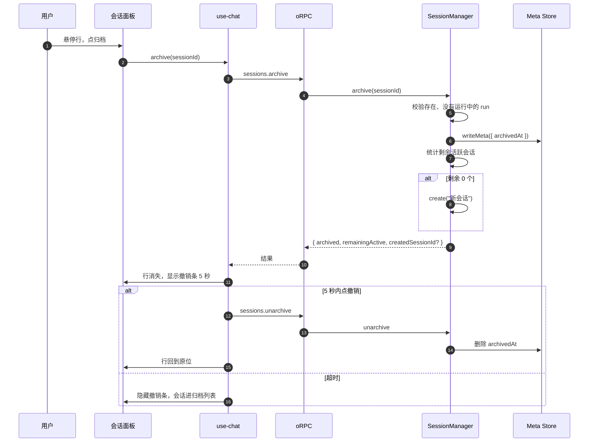

**彻底删除。** 顺序固定：先删 JSONL，再删元数据。

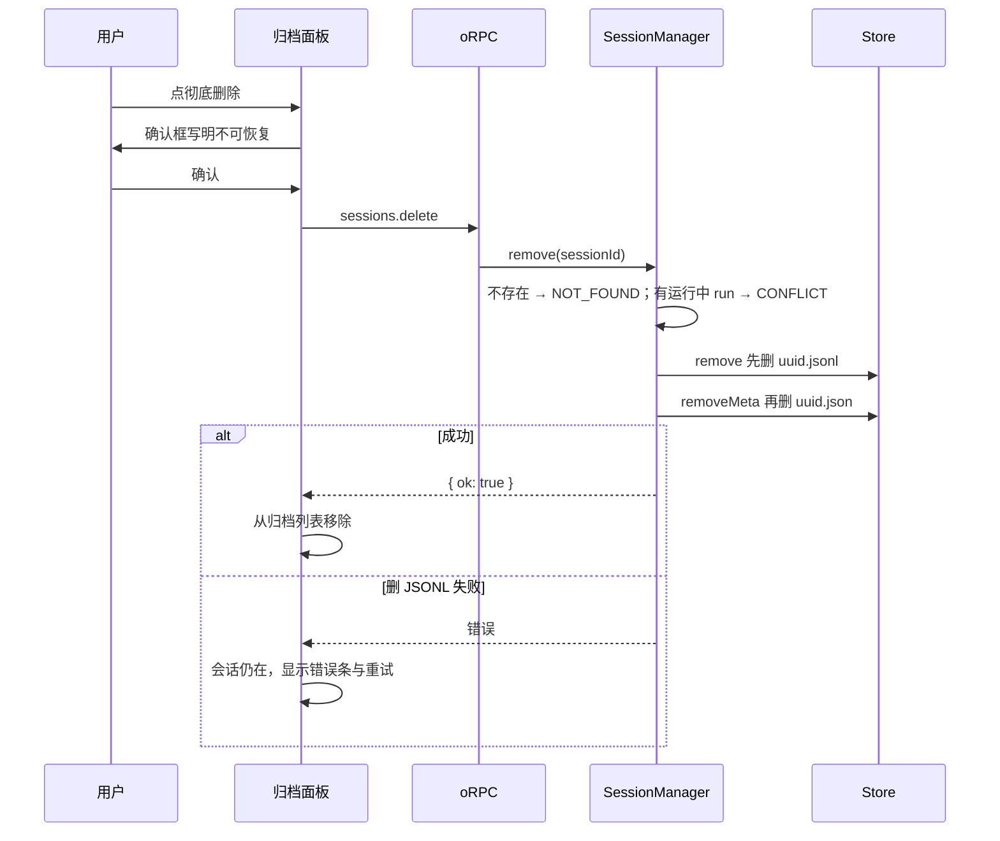

**改名。** 只写元数据；空名与 Esc 不调接口。

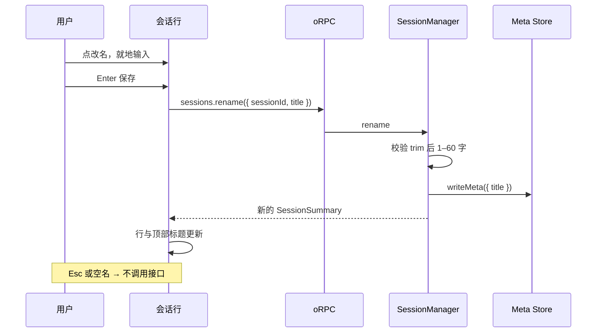

### 3.5 会话状态

会话只有两个持久状态。运行状态是另一条线，不写在这里。

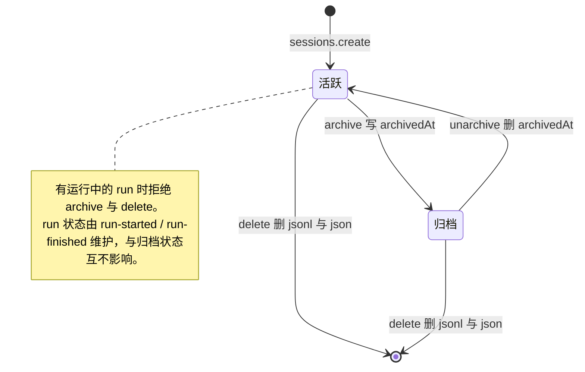

### 3.6 用户在界面上怎么走

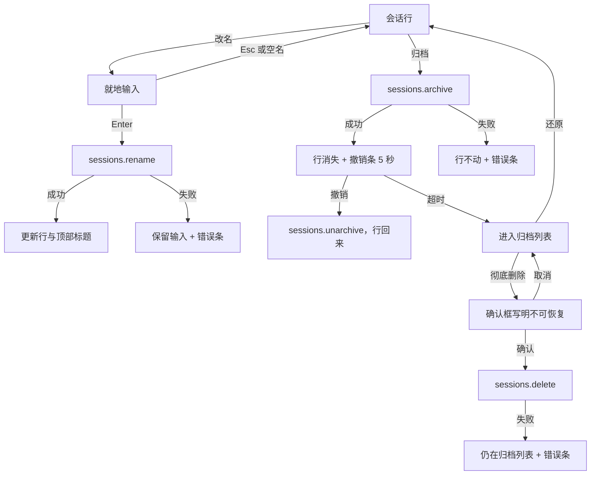

失败分支都有落点，不做乐观删除。

### 3.7 三层职责

| 概念 | 长期存储记录 | 模型协议消息 | UI 展示消息 | 转换点 |
| --- | --- | --- | --- | --- |
| 会话元数据 | `sessions/uuid.json`（新增） | 不进入 | `SessionSummary.archivedAt` | `summaryOf()` |
| 对话消息 | `message-added` | user / assistant / tool | `ChatMessage { id, role, content }` | `toHistory()` 给模型，`view()` 给界面 |
| 运行状态 | `run-started` / `run-finished` | 未完成运行折成一条说明 | `runs[].status` 与中断提示 | `restore()` |
| 未发送草稿 | 不落盘 | 不进入 | 输入框内部 state | 无；PR #4 需去掉现有持久化 |

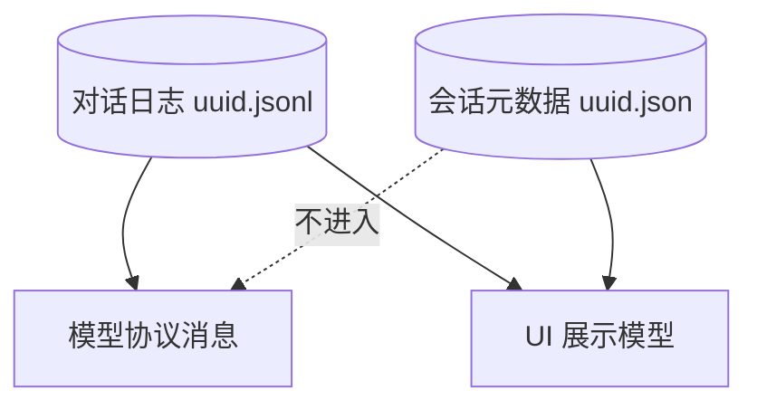

所以：**元数据不是消息**。它不参与 `toHistory`，不改变 Run 折叠，也不会让旧读卡器整条会话读不出来。

## 4. 对后续架构的影响

这次改完，会话存储从"一个文件"变成"对话日志 + 元数据"两层。后面加东西的位置就定了：

- 分类、置顶、批量操作、搜索：都加在元数据层，`list` 加过滤参数。不用迁移旧会话，不动 JSONL。
- 新消息形式（附件、结果卡片）：只改消息链路（`records.ts` → `session.ts` → 契约 → UI），会话管理不受影响。
- 备份与清理：用户要备份会话时，`sessions/` 目录整体拷走即可，两层都在里面。
- 新约束：任何"给会话加属性"的需求，默认落在元数据；不要再往 JSONL 加记录类型。

## 5. 模块影响

| 包/文件 | 改什么 | 为什么 | 风险 |
| --- | --- | --- | --- |
| `packages/contracts/src/index.ts` | `SessionSummary` 加 `archivedAt?`；新增四个接口；`list` 加 `archived` 入参 | 界面需要归档时间与行内操作 | 契约一改，插件与 Service 必须同版本发布 |
| `apps/agent-service/src/session/meta.ts`（新） | 元数据 schema 与路径规则 | 把"会话属性"从对话记录里分出来 | 多一份 schema 要维护 |
| `apps/agent-service/src/session/jsonl-store.ts` | 加 `readMeta / writeMeta / removeMeta / remove`，共用按会话队列 | 文件级操作收敛在 Store，Manager 不碰 fs | 元数据写入必须原子，否则半文件会导致状态错 |
| `apps/agent-service/src/session/session.ts` | `summaryOf()`、`rename / archive / unarchive / remove`；`list` 过滤；`beginRun` 拒绝归档会话 | 业务规则单点可测 | 方法变多，注意 `active` 与文件操作顺序 |
| `apps/agent-service/src/rpc/rpc.ts` | 绑定四个 handler；错误映射 `NOT_FOUND` / `CONFLICT` | UI 要区分失败原因 | 现有 `failure()` 会把所有错误压成通用文案（`rpc.ts:25-28`） |
| `packages/ui/src/` | 新增会话面板、归档面板、撤销条、确认框；`SessionToolbar` 改成"会话名 + 新建 + 箭头"；`ChatPanel` 去掉"对话"标题 | PRD 的界面结构 | 组件变多，要保持宿主无关 |
| `apps/obsidian-plugin/src/chat-view/use-chat.ts` | 增加四个操作、归档列表、撤销定时器、错误分支 | 界面状态与 RPC 编排在这一层 | 定时器与请求竞态 |
| `apps/obsidian-plugin/public/styles.css` | 顶部精简、行内悬停态、撤销条、窄宽度 | 视觉与留白 | 与宿主主题变量兼容 |
| `docs/architecture/current-runtime.md`、`evolution.md` | 实现合入时更新会话接口与存储说明，补演进记录 | 当前架构只写已实现事实 | 本阶段先不改 |

删除的一致性：先删 JSONL 再删元数据。JSONL 失败则整体失败；元数据残留不会被 `ids()` 列出，可在下次 `list()` 顺手清理。

## 6. 兼容与迁移

| 场景 | 会发生什么 | 要做什么 |
| --- | --- | --- |
| 旧会话（没有元数据文件） | 视为活跃；标题走派生规则 | 无 |
| 旧 JSONL | 格式与 `version: 1` 不变，照常读 | 无 |
| 元数据文件损坏 | 按默认值读，会话仍可用 | 不删文件，下次写入覆盖 |
| 旧版本客户端（用户回退） | 忽略 `*.json`，归档会话重新出现在列表 | 不丢数据、不报错；可接受 |
| 回滚 | 删除 `sessions/*.json` 即回到旧行为 | 无迁移脚本 |

迁移步骤：无。唯一的一次性动作在 PR #4（去掉引用草稿持久化），属于它自己的改动。

## 7. 备选方案

### 7.1 方案 A：元数据写进 JSONL（最小改动）

做法：新增 `session-renamed / session-archived / session-unarchived` 记录，追加进同一个文件，`restore()` 折叠出最新值。

- 改动面：`records.ts` 联合扩容，`session.ts` 重排 `restore()`，其余同推荐方案。改的文件最少。
- 代价：`restore()` 现在假定"除会话头外都属于 Run"（`session.ts:40-50`），加类型必须重写这段校验；旧版本读到未知类型直接失败，回退等于所有会话读不出来；元数据写入会改变 `updatedAt` 与排序。
- 扩展：分类、置顶只能继续加记录类型，日志越来越杂。

### 7.2 方案 B：元数据旁挂文件（推荐）

做法：每个会话一份 `sessions/uuid.json`，原子写，缺省即默认；JSONL 完全不动。首次改名或归档时才创建这个文件。

- 改动面：Store 加四个方法，Manager 合并元数据，契约与 UI 同方案 A。
- 代价：目录里多一类文件（N 个会话 2N 个文件）；跨文件的只有"彻底删除"，用固定顺序 + 残留可清理兜底；多一份小 schema 与"损坏按默认值"的约定。
- 扩展：加字段是加法；以后要换索引或单文件，只改 Store 内部，不动契约。

### 7.3 方案 C：归档 = 把文件移到 `sessions/archive/`

做法：活跃列表扫主目录，归档列表扫子目录；还原就是移回来。

- 改动面：`pathFor` 要按状态解析，`read / append / remove` 都要先找位置。
- 代价：同一会话路径随状态变化，失败模式变多；归档时间只能靠 mtime；以后分类仍要另加元数据，等于两套机制。
- 扩展：最差。只适合"归档即搬家"的极简需求。

三方案对比：

| 维度 | A 写进 JSONL | B 旁挂文件（推荐） | C 移目录 |
| --- | --- | --- | --- |
| 改的文件 | 最少 | 中 | 中 |
| 旧数据迁移 | 无 | 无 | 需要移动或兼容旧路径 |
| 回退旧版本 | 会话读不出来 | 归档会话重新出现 | 归档会话看不到 |
| 以后加分类 | 继续加记录类型 | 元数据加字段 | 还要另做元数据 |
| 主要风险 | 读取层重写 | 两层文件一致性 | 路径随状态变化 |

## 8. 推荐与理由

推荐 **B**。

1. 三个边界干净：对话日志只存对话，元数据不参与 `toHistory`，旧读卡器不会崩。
2. 迁移成本为零：没有旧文件要改；回退只是"忽略元数据"。
3. 扩展位置正确：分类、置顶、排序以后都加在元数据对象上。
4. 可测：元数据读写、合并、派生标题都是纯函数级别。

不做什么：

- 不做通用 content-parts；
- 不做事件溯源/命令日志；
- 不做软删除墓碑记录；
- 不引入 SQLite 或全局索引文件；
- 不做多窗口同步。

代价：多一个文件类型、一条一致性约定、一份小 schema；`.jelly/sessions` 下文件数翻倍，个人 Vault 规模可接受。

需要你拍板的三件事：

1. 元数据存哪：旁挂 `uuid.json`（推荐）还是写进 JSONL（回退会读不出会话）。
2. `sessions.delete` 语义：直接不可逆删除（推荐，界面只在归档列表露出，服务端只校验存在且无运行中任务）还是必须"先归档再删"。
3. 归档最后一个会话：服务端同一次调用里新建（推荐，无客户端竞态）还是客户端判断后补建。

## 9. 未来扩展演练

假设下一轮新增一种消息形式：**用户发文件附件，assistant 返回结果卡片**。

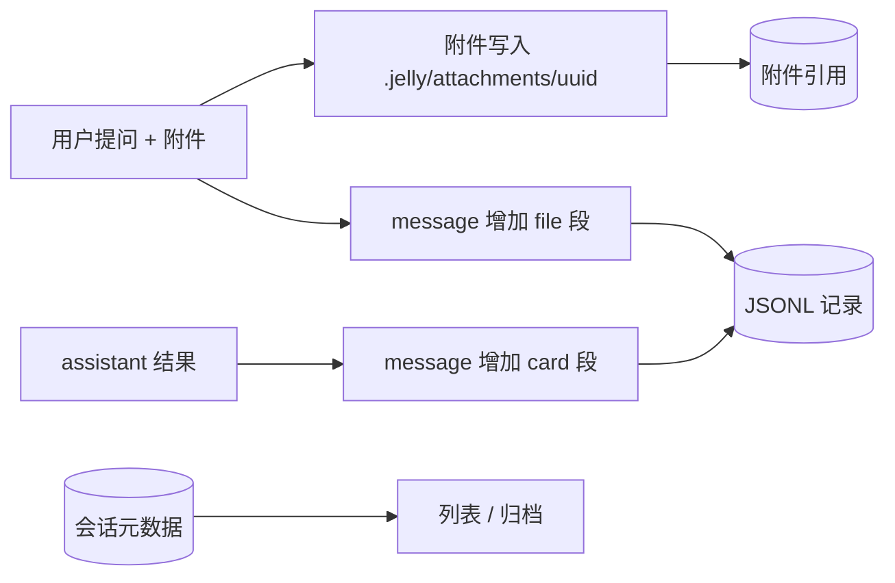

要改的公共部分（与方案无关）：

| 模块 | 改动 |
| --- | --- |
| `packages/contracts` | `chatGenerateInput` 加 `attachments`；流式事件加一种 |
| `packages/domain` | `ChatMessage` 从纯文本扩成分段；`AgentOutputEvent` 加一种 |
| `apps/agent-service` | 附件二进制落盘；`messageSchema` 加消息形态；`view()` 拍平成 UI 结构；删会话时清附件 |
| `packages/ui` | 附件与卡片渲染；消息渲染分支 |

按方案看差异：

| 环节 | A 写进 JSONL | B 旁挂文件（推荐） | C 移目录 |
| --- | --- | --- | --- |
| 加新消息形态 | 同一文件里要同时判断元数据与消息版本 | 只改消息链路，元数据路径不受影响 | 同 B，但归档目录里的旧文件也要能被同一条读取路径找到 |
| 旧 JSONL | 要按行判版本或整体重写 | 新形态用版本协商读取，旧消息按纯文本读 | 同 B |
| 旧客户端 | 硬失败，整条会话读不出 | 元数据被忽略，会话仍可读 | 归档会话看不到 |
| 附件清理 | 删 JSONL + 附件 | 删 JSONL + 元数据 + 附件，顺序固定 | 删两个目录 + 附件，最容易漏 |
| 代价 | 中高 | 中 | 高 |

结论：新消息形式无论哪个方案都要动契约、领域类型、存储 schema、UI；差别在**读取兼容与回退**。B 把会话管理和消息形态解耦，下一轮只面对后者。

## 10. 测试策略

| 层 | 测什么 | 怎么测 |
| --- | --- | --- |
| Store | 元数据缺失 / 损坏返回默认；写后读；`remove` 后 `ids()` 不再返回；元数据不被当成会话；同会话写入串行 | 新增 `jsonl-store.test.ts`，临时目录，复用 `session.test.ts` 的模式 |
| Manager | 改名落盘且重启生效；空名/超长被拒；归档过滤；还原；归档最后一个自动新建；删除运行中会话被拒；已归档会话拒绝 `beginRun` | `session.test.ts` 增补，用现有 `createSessionManager` + 临时目录 |
| 派生标题 | 首问摘要、改名优先、无提问用头标题；`list` 与 `view` 一致；元数据写入不改 `updatedAt` | 同上 |
| RPC | 四个接口端到端；错误码映射；重启后状态保持 | `apps/obsidian-plugin/src/rpc/client.test.ts` 增补，沿用 `app.request` |
| UI 渲染 | 列表行可访问名称、图标 `aria-label`、归档面板、确认框含"不可恢复"、顶部没有品牌名与"对话"标题 | `renderToStaticMarkup`，沿用 `chat-panel.test.tsx` 的模式 |
| 客户端逻辑 | 撤销定时器（注入时钟，5 秒触发）、改名状态迁移、错误分支 | 纯模块直接测，不依赖渲染 |
| 模型上下文 | 元数据不进历史 | 沿用 `session.test.ts` 的 `seen: AgentMessage[][]` 断言 |
| 真实 Obsidian | 改名/归档/撤销/删除后重启；280/360px；亮暗色；失败路径 | 人工清单，写进 `verification.md` |

不做：多窗口同步、跨进程并发、崩溃注入。

## 11. ADR

- 提案：`docs/architecture/decisions/0004-session-metadata-storage.md`，状态 `proposed`。
- 用户确认后改 `accepted`；实现合入后再改 `implemented`。

## 12. 未决问题

| 问题 | 影响 | 需要谁回答 | 当前建议 |
| --- | --- | --- | --- |
| 自动标题截断长度、是否去 Markdown | 列表观感 | 产品设计师 | 24 个字符，折叠换行与多余空白 |
| 归档列表排序 | 归档面板行序 | 产品设计师 | 按 `archivedAt` 倒序 |
| 顶部"刷新会话"图标是否保留 | 界面元素数量 | 产品设计师 | 去掉，打开列表时刷新 |
| 归档是否显示数量/角标 | 范围 | 产品设计师 | 本轮不做 |
| 外部工具删了 JSONL 怎么办 | 错误提示 | 架构师后续 | 列表跳过该会话，不额外设计 |

## 13. 交接

- 下一阶段：规划中
- 进入条件：用户在「方案待确认」确认上述三个关键选择（或直接采纳推荐），ADR 0004 从 `proposed` 改为 `accepted`。
- 规划阶段需要读：本文件、`intent.md`、`docs/architecture/current-runtime.md`、`apps/agent-service/src/session/*`、`packages/ui/src/SessionToolbar.tsx`、`apps/obsidian-plugin/src/chat-view/use-chat.ts`。
