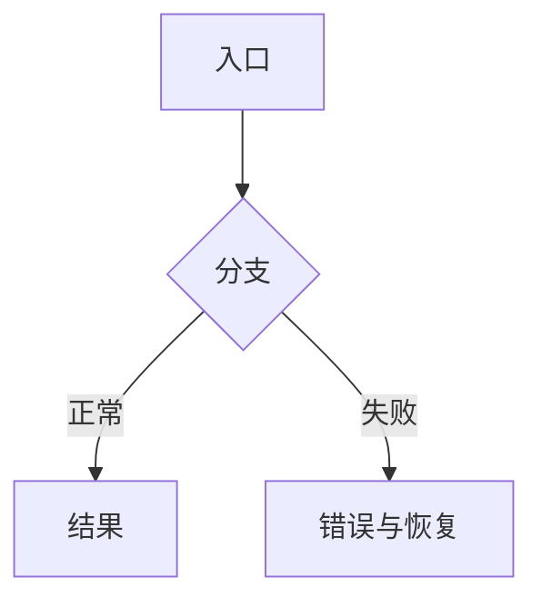

# <一句话标题>

## 一句话

这个功能让谁，在什么情况下，能做什么。

## 问题

- 现在用户怎么做。
- 哪一步卡住，证据是什么。
- 为什么现在要做。

## 目标

- 用户能观察到的行为变化。
- 本轮只解决哪一段。

## 不做

- 本轮明确不处理的场景。
- 不扩展到的模块或功能。

## 场景

### 场景 1：<名字>

- 谁：
- 什么时候：
- 现在怎么做：
- 有了之后怎么做：
- 图：流程图 / 界面原型 / 状态图

### 场景 2：<名字>

- 同上。

## 方案

### 流程

### 界面与状态

- 正常：
- 空白：
- 生成中：
- 失败：
- 取消/恢复：
- 配图：Paper 页面链接或截图

## 需要你定

1. <问题>：A <选项>（推荐）｜B <选项>｜C <选项>
2. <问题>：A <选项>｜B <选项>

回复“1A 2A”即可。

## 验收

- [ ] 用户可观察、可复现的行为。
- [ ] 每条对应一个测试或手工验收步骤。
- [ ] 前后对比截图（如涉及界面）。

## 风险

- 用户可能误解的地方。
- 数据、兼容、多窗口、性能等边界。

## 原型

- Paper：`Jelly · Obsidian UI Kit` → `<JELLY-id> · <feature>`
- 链接：

## 交接

- 下一阶段：架构方案
- 进入条件：用户对“需要你定”的问题给出结论
- 需要读：本文件、Paper 原型、`docs/architecture/current-runtime.md`
