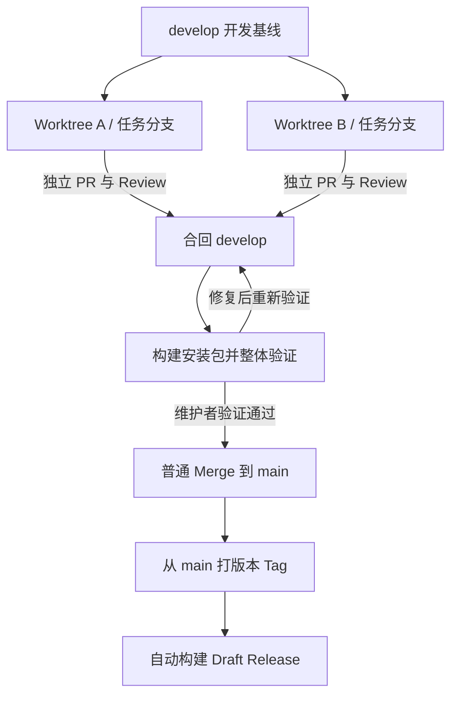

# 分支管理与发版约定

本项目采用 `develop` 集成验证、`main` 保持稳定、Tag 标记正式版本的流程。暂不维护长期 `release` 分支。



## 分支职责

| 分支或标记         | 用途                                 | 进入条件                                                                        |
| ------------------ | ------------------------------------ | ------------------------------------------------------------------------------- |
| `codex/<任务名>`   | 单个任务的开发与 Review              | 允许未完成，未完成时使用 Draft PR                                               |
| `develop`          | 多任务集成、构建验证包、集中手动验证 | 单任务已 Review，相关检查通过；允许尚未充分验证，不合入已知基本功能不可用的代码 |
| `main`             | 已经过维护者整体验证的稳定代码       | 从 `develop` 晋级，或经过验证的紧急修复                                         |
| `0.1.5` 等版本 Tag | 标记正式版本的确定提交               | 提交位于 `main`，版本与 manifest 一致，不带 `v`                                 |

GitHub 仓库默认分支为 `develop`，新建 PR 默认指向它。`main` 是稳定分支，不要求每次晋级立即发版。

## 日常开发与 PR

1. 从最新的 `origin/develop` 创建任务分支。并行任务各自使用一个分支和 Worktree；同一 Worktree 可在任务结束后复用。
2. 每个任务独立提交 PR、Review，不把多个无关任务混在一个 PR 中。
3. 合入前完成 Review，运行 `pnpm check`、相关测试和 `pnpm build`；需要完整回归时运行 `pnpm test`。未完成或已知不可用的任务继续留在任务分支。
4. 常规任务 PR 合入 `develop`。任务 PR 可按需要 Squash，保留一个清晰的任务提交。
5. 已有分支可以继续使用；提交 PR 前检查 base，必要时先合入最新 `origin/develop`，解决冲突并重新检查。

```sh
git fetch origin
git switch -c codex/my-task origin/develop
# 开发、检查并提交后
git push -u origin codex/my-task
gh pr create --base develop
```

以上为当前 checkout 开分支的示例；并行开发时在各自 Worktree 内操作。显式指定 `--base develop`，避免工具缓存或个人配置导致 PR 指向错误分支。

## L1 端到端回归

前置：Node >= 20.19.0、pnpm 10.25.0；需要允许绑定本机回环端口。不需要安装 Obsidian，也不需要真实模型 Key。

```sh
pnpm install --frozen-lockfile
pnpm build
pnpm test:e2e
```

`test:e2e` 使用 Node 自带测试运行器与已有 tsx；和 `pnpm test` 的 Vitest 单测分开。它启动构建后的 `apps/agent-service/dist/agent-service.mjs`，通过与插件相同的 oRPC 客户端库走真实 HTTP；模型端是仅监听 `127.0.0.1` 的 OpenAI-compatible SSE 服务。修改服务代码后必须重新构建，测试不会自动构建。

每次运行在 `.e2e-artifacts/l1-*/vault/` 创建独立 Vault，预置一份 Markdown。资料根目录和 `.jelly/sessions` 都位于该 Vault 内；服务工作目录也隔离，环境变量只传入测试配置，不继承仓库 `.env`、真实模型凭据和代理。无需 SecretStorage 或测试专用生产代码。

用例覆盖：分片流式回复、分片工具参数、读取及创建真实 Markdown、工具失败后的回复、模型 HTTP 503、取消后的会话释放、服务重启后的历史恢复及续聊、进程崩溃后的 interrupted 恢复。假模型会校验工具返回的资料与恢复后的上下文，错误不会被当作正常回复。

失败返回非零。就绪等待、RPC 和测试均有超时；结束时停止本次启动的服务进程并关闭假模型连接，服务停止超时会强制退出。服务端口使用动态空闲端口，分配与进程监听之间仍有竞争窗口；冲突会使测试失败并留下日志，不会连接到未通过随机令牌检查的服务。

日志与数据保留在 gitignored 的 `.e2e-artifacts/`：`service-N.log` 是每次启动的 stdout/stderr，`trace.jsonl` 记录假模型请求、SSE 响应、RPC 展示事件和进程退出，`vault/.jelly/sessions/*.jsonl` 可核对持久化。该目录只有合成测试资料，可在排查后删除。L1 不含图形界面，不产生截图或浏览器 trace。测试报告在终端输出；需要归档可使用 `pnpm test:e2e > .e2e-artifacts/run.tap 2>&1`，仍须检查命令退出码。

### L2 与 CI 边界

L1 验证独立服务，不能证明 Obsidian 插件加载、侧栏 UI、SecretStorage、Electron utilityProcess 或重启 Obsidian 的行为。当前阶段按 JELLY-6 的人工确认先交付 L1；L2 的实际探索与运行记录见 `docs/changes/JELLY-6-e2e-harness/plan.md`。

后续真实宿主优先评估 [wdio-obsidian-service](https://github.com/jesse-r-s-hines/wdio-obsidian-service)：它支持独立 Vault 副本、插件加载、Obsidian app/installer 版本选择和下载缓存。应固定两个版本，使用隔离用户配置，先经设置页接入本地假模型，再运行少量 UI 关键路径。若 WDIO 路线受阻，可评估 Playwright/CDP。用户计划提供专用 Mac mini；它适合作为后续宿主验证环境，仍需验证登录会话、显示、凭据存储和清理。

CI 结论：L1 没有图形宿主依赖，可作为后续 Linux PR CI 的候选命令；本期未接入或实测 Linux runner。L2 本期不进入 PR 门禁；macOS runner 的下载安装、显示会话、版本兼容性、冷/热缓存耗时及费用尚未实测，不能承诺稳定性或报价。后续先测专用 Mac，再决定按需 CI。CI 门禁、技能和流程模板变更属于 Phase 2。

## 集中验证与晋级 main

- 开始一轮整体验证时暂停向 `develop` 合入新功能；其他 Worktree 可继续开发。验证期间只合入必要修复。
- 如准备发版，先在 `develop` 更新 `manifest.json`、根 `package.json`、`versions.json` 和 `docs/release-notes.md`；依赖变更时更新许可证声明。
- 在 GitHub Actions 的 **Prepare release → Run workflow** 中选择 `develop`，下载该次运行的 `jelly-release` artifact。也可在本地运行以下命令：

```sh
pnpm check
pnpm test
pnpm build:verify
pnpm release:prepare
```

- 在测试 Vault 中安装 `dist/release/` 的 ZIP，验证真实 Obsidian 中的启动、设置、模型对话、会话恢复及本轮变更涉及的功能。涉及文件写入时使用测试资料。
- 记录已验证的提交 SHA、环境和结果；验证后如有新提交，需要重新验证受影响的功能。自动化检查通过不能代替维护者的真实宿主验证。
- 验证通过后创建 `develop → main` 的晋级 PR，并在 PR 中记录验证结果。使用普通 **Create a merge commit** 合并，不使用 Squash 或 Rebase，保持两个长期分支的共同历史。
- 合并后 `main` 的文件内容应与已验证的 `develop` 一致；如晋级时发生冲突或需要改动，先将 `main` 同步到 `develop` 并重新验证，不在晋级时临时修代码。
- 晋级完成后恢复新功能集成。若以后需要验证当前版本的同时持续集成下一版，再考虑临时 `release/*` 分支。

## Tag 发版

只从已验证的 `main` 提交创建正式 Tag。Tag 只标记版本，不用来承载继续开发的改动；已发布 Tag 不移动、不覆盖，修复通过新版本发布。

以版本 `0.1.5` 为例，先确认晋级 PR 已合并、版本文件与发布说明正确，再执行：

```sh
git fetch origin
git switch main
git merge --ff-only origin/main
git status --short
git log -1 --oneline
# 确认工作区干净，且 HEAD 是本次经过验证的提交
git tag -a 0.1.5 -m 'Jelly 0.1.5'
git push origin 0.1.5
```

推送 Tag 后，现有 `release.yml` 会检查、构建、校验版本与 Tag 一致，并创建 **Draft Release**。检查该次产物与草稿说明后，由维护者手动发布。GitHub Actions 手动选择 `develop` 运行只上传验证产物，不创建正式 Release。

现有工作流会响应匹配的版本 Tag，但不会自动限制该 Tag 必须来自 `main`；发版时必须检查目标提交。本约定不自动执行发版，也不自动向 Obsidian 社区目录提交。

## 紧急修复

当 `develop` 尚未稳定、已发布版本需要紧急修复时，从最新 `origin/main` 创建修复分支，单独 Review、验证后 PR 到 `main`，再按上述流程发布新 Tag。随后通过 PR 将 `main` 的修复同步回 `develop`，使用普通 Merge，避免后续版本遗漏修复。
